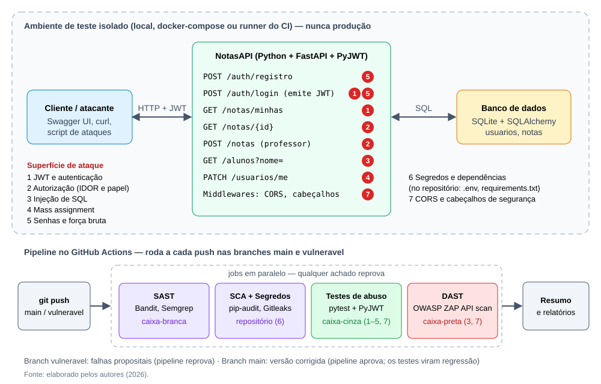

# NotasAPI — Testes de Segurança (Security Testing)

Exemplo prático da pesquisa **Testes Não Funcionais: Testes de Segurança**, da disciplina de
Qualidade e Testes de Software (6º semestre DSM — FATEC São José dos Campos, Prof. Lucas Nadalete).

A **NotasAPI** é uma API REST simples de notas acadêmicas (FastAPI + SQLite + JWT). Ela foi construída
**com falhas de segurança propositais** para mostrar, na prática, o que cada técnica de teste de
segurança consegue detectar automaticamente antes de o código chegar à produção.

> ⚠️ **Uso ético:** rode a API e os ataques **somente no seu ambiente local**. Testes ativos de
> segurança contra sistemas de terceiros sem autorização são ilegais (Lei 12.737/2012).



## As duas branches

| Branch | Conteúdo | Pipeline |
|---|---|---|
| [`vulneravel`](https://github.com/Equipe-Skyfall/Security-Testing/tree/vulneravel) | API com as falhas descritas abaixo, inseridas de propósito | ❌ reprova |
| [`main`](https://github.com/Equipe-Skyfall/Security-Testing/tree/main) | Mesma API com as correções | ✅ aprova |

Os **mesmos testes** rodam nas duas: na `vulneravel` eles falham (provam que a falha existe) e na
`main` passam, passando a funcionar como **testes de regressão** a cada commit.
Para ver o "antes e depois" de cada correção: `git diff vulneravel main -- app/`.

| # | Falha na `vulneravel` | Correção na `main` |
|---|---|---|
| 1 | Segredo do JWT fixo e fraco (`segredo123`); assinatura e expiração não verificadas; aceita `alg: none` | Segredo forte lido de variável de ambiente; `jwt.decode` com algoritmo fixo `HS256`, assinatura e `exp` obrigatórios |
| 2 | `GET /notas/{id}` não confere o dono (IDOR/BOLA) | Só o dono ou um professor; responde 404 para não revelar a nota |
| 2 | `POST /notas` não confere o papel | Exige papel `PROFESSOR`, lido do banco e não do token |
| 3 | `GET /alunos?nome=` concatena texto no SQL | Consulta parametrizada pelo ORM |
| 4 | `PATCH /usuarios/me` aceita qualquer campo (mass assignment) | Esquema Pydantic com `extra="forbid"` (só `nome` e `email`) |
| 5 | Senhas em MD5 sem salt; login sem limite de tentativas | bcrypt; HTTP 429 após 5 senhas erradas |
| 6 | `.env` com chave de API versionado; `PyJWT 2.3.0` com CVEs | `.env` no `.gitignore`; dependências atualizadas |
| 7 | CORS `*` e nenhum cabeçalho de segurança; `/docs` sempre exposto | CORS restrito; `nosniff`, `X-Frame-Options`, CSP, `no-store`; `/docs` só com `EXPOR_DOCS=true` |

## Como executar

Pré-requisitos: Python 3.12+ (ou Docker).

```bash
git clone https://github.com/Equipe-Skyfall/Security-Testing.git && cd Security-Testing/notasapi
git checkout main            # ou: git checkout vulneravel

python -m venv .venv
source .venv/bin/activate    # Windows: .venv\Scripts\activate
pip install -r requirements.txt -r requirements-dev.txt
```

### Testes de segurança automatizados (pytest)

```bash
pytest
```

### Subir a API

```bash
# Linux/macOS
export JWT_SECRET=$(python -c "import secrets; print(secrets.token_hex(32))") EXPOR_DOCS=true
# Windows (PowerShell)
$env:JWT_SECRET = python -c "import secrets; print(secrets.token_hex(32))"; $env:EXPOR_DOCS = "true"

uvicorn app.main:app --port 8000
```

Ou com Docker (na `main`, antes faça `cp .env.example .env` e preencha `JWT_SECRET`):

```bash
docker compose up --build
```

Documentação interativa: <http://127.0.0.1:8000/docs>

Usuários de demonstração (fictícios, criados ao subir a API):

| E-mail | Senha | Papel |
|---|---|---|
| carla@escola.br | `Professora@2026` | PROFESSOR |
| ana@escola.br | `AnaAluna@2026` | ALUNO |
| bruno@escola.br | `BrunoAluno@2026` | ALUNO |

### Demonstração dos ataques

Com a API no ar, em outro terminal:

```bash
python scripts/demo_ataques.py
```

O script faz login como a aluna Ana e tenta: (1) ler notas de outros alunos trocando o id
(IDOR), (2) se promover a professora via mass assignment, (3) lançar nota para si mesma e
(4) extrair e-mails e hashes de senha por injeção de SQL. Na `vulneravel` tudo funciona;
na `main` tudo é bloqueado.

Os ataques alteram o banco (a Ana vira professora na `vulneravel`). Para voltar aos dados
iniciais, pare a API e apague o arquivo `notas.db` (no Docker: `docker compose down`).

### Ferramentas de análise (as mesmas da pipeline)

```bash
pip install bandit semgrep pip-audit
bandit -r app -ll                                              # SAST
semgrep scan --config p/python --config p/jwt --error app      # SAST
pip-audit -r requirements.txt                                  # SCA
gitleaks git --log-opts="HEAD" -v .                            # Segredos (https://github.com/gitleaks/gitleaks)
```

## Pipeline de CI (GitHub Actions)

[`.github/workflows/seguranca.yml`](../.github/workflows/seguranca.yml) (na raiz do repositório) roda a cada push em
`main` e `vulneravel` (e manualmente pela aba **Actions → Run workflow**):

```
commit → SAST (Bandit, Semgrep) → SCA (pip-audit) → Segredos (Gitleaks) → pytest → DAST (OWASP ZAP) → resumo + relatórios
```

Os jobs rodam em paralelo; cada um reprova a pipeline se encontrar algo. Os relatórios ficam
em **Artifacts** de cada execução e o quadro-resumo aparece na página da execução.
O ZAP roda em modo *API scan*, importando o `/openapi.json` gerado pelo FastAPI e autenticado
com o token de uma aluna; as regras que reprovam estão em [`.zap/rules.tsv`](.zap/rules.tsv).

## Casos de teste

| ID | Cenário de ataque | Esperado na `main` | Onde | OWASP |
|---|---|---|---|---|
| CT01 | Rota protegida sem token | 401 | `tests/test_autenticacao.py` | API2 |
| CT02 | Token assinado com outro segredo / segredo de wordlist | 401 | `tests/test_autenticacao.py` | API2 |
| CT03 | Token com `alg: none` ou papel alterado no payload | 401 | `tests/test_autenticacao.py` | API2 |
| CT04 | Token expirado | 401 | `tests/test_autenticacao.py` | API2 |
| CT05 | Aluno lançando nota | 403 | `tests/test_autorizacao.py` | API5 |
| CT06 | Aluno A lendo nota do aluno B | 403/404 sem vazamento | `tests/test_autorizacao.py` | API1 |
| CT07 | `"papel": "PROFESSOR"` no PATCH | 422; papel inalterado | `tests/test_autorizacao.py` | API3 |
| CT08 | Injeção de SQL em `/alunos?nome=` | nenhum dado extra | `tests/test_injecao.py` + Bandit + Semgrep + ZAP | A03 |
| CT09 | Força bruta no login | 429 após o limite | `tests/test_autenticacao.py` | API4 / A07 |
| CT10 | Senha gravada no banco | hash bcrypt | `tests/test_autenticacao.py` + Bandit + Semgrep | A02 |
| CT11 | Origem não autorizada (CORS) | sem `Allow-Origin` | `tests/test_configuracao.py` + Semgrep + ZAP | A05 |
| CT12 | Segredos versionados | nenhum | Gitleaks | A05 |
| CT13 | Dependências com CVE | nenhuma | pip-audit | A06 |
| CT14 | Padrões inseguros no código | nenhum achado médio/alto | Bandit + Semgrep | SAST |
| CT15 | Cabeçalhos de segurança e `/docs` | presentes / desativado por padrão | `tests/test_configuracao.py` + ZAP | A05 |
| CT16 | E-mail já usado em `PATCH /usuarios/me` (achado do ZAP) | 409, sem erro 500 | `tests/test_configuracao.py` + ZAP | A05 |

*API = OWASP API Security Top 10 (2023); A = OWASP Top 10 (2021).* Os testes marcados como
"(controle)" verificam que o uso legítimo continua funcionando depois das correções.

## Resultados: o que cada técnica detectou

| Falha | pytest | Bandit | Semgrep | pip-audit | Gitleaks | ZAP |
|---|:-:|:-:|:-:|:-:|:-:|:-:|
| Segredo JWT fraco no código | ✅ CT02 | ⚠️ baixa (B105) | — | — | — (baixa entropia) | — |
| Assinatura/expiração do JWT não verificadas, `alg none` | ✅ CT02–04 | — | ✅ | — | — | — |
| IDOR (nota de outro aluno) | ✅ CT06 | — | — | — | — | — |
| Aluno lança nota | ✅ CT05 | — | — | — | — | — |
| Mass assignment (papel) | ✅ CT07 | — | — | — | — | — |
| Injeção de SQL | ✅ CT08 | ✅ B608 | ✅ | — | — | ✅ alto (40018) |
| MD5 sem salt | ✅ CT10 | ✅ B324 | ✅ | — | — | — |
| Força bruta no login | ✅ CT09 | — | — | — | — | — |
| CORS `*` / cabeçalhos ausentes | ✅ CT11, CT15 | — | ✅ (CORS) | — | — | ✅ (40040, 10021) |
| Chave de API no `.env` versionado | — | — | — | — | ✅ | — |
| PyJWT 2.3.0 com CVEs | — | — | — | ✅ (18 avisos) | — | — |
| HTTP 500 com e-mail duplicado (**não planejado**) | — | — | — | — | — | ✅ (90022) |

Totais na `vulneravel`: pytest 16 falhas de 21 · Bandit 2 achados médio/alto (+1 baixo) ·
Semgrep 5 · pip-audit 18 avisos em 1 pacote · Gitleaks 1 · ZAP 3 alertas que reprovam.
Na `main`: tudo zerado (o ZAP só deixa 2 alertas informativos, ignorados em `rules.tsv`).

**Leitura crítica:** as falhas de **lógica de autorização** (IDOR, papel, mass assignment, força
bruta) passam despercebidas por todas as ferramentas genéricas — só aparecem nos testes escritos
pela equipe, que conhecem a regra de negócio. Já as ferramentas automáticas pegam muito bem
padrões conhecidos (SQL concatenado, MD5, CORS `*`, CVEs, chaves de alta entropia). O segredo
`segredo123` mostra o limite de cada uma: o Gitleaks não o reconhece (baixa entropia), o Bandit
só avisa com severidade baixa e quem prova o risco é o teste CT02, que assina tokens com uma
lista de senhas comuns. Por outro lado, o ZAP achou um erro 500 que a equipe **não** havia
plantado, e o achado virou o teste de regressão CT16. Nenhuma técnica sozinha basta: por isso a
estratégia é **em camadas**.

## Estrutura

```
app/            código da API (config, segurança, rotas, esquemas, modelos, dados de exemplo)
tests/          testes de segurança (pytest + TestClient do FastAPI + PyJWT)
scripts/        script de demonstração dos ataques
.zap/rules.tsv  regras do OWASP ZAP que reprovam a pipeline
docs/           ilustração da arquitetura
```

## Referências das ferramentas

- FastAPI — Testing: <https://fastapi.tiangolo.com/tutorial/testing/>
- pytest: <https://docs.pytest.org/> · PyJWT: <https://pyjwt.readthedocs.io/> · bcrypt: <https://pypi.org/project/bcrypt/>
- Bandit: <https://bandit.readthedocs.io/> · Semgrep: <https://semgrep.dev/docs/>
- pip-audit: <https://github.com/pypa/pip-audit> · Gitleaks: <https://github.com/gitleaks/gitleaks>
- OWASP ZAP: <https://www.zaproxy.org/docs/> · GitHub Actions: <https://docs.github.com/actions>
- OWASP API Security Top 10 (2023): <https://owasp.org/API-Security/> · OWASP Top 10 (2021): <https://owasp.org/www-project-top-ten/>
